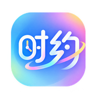

# 《时约》CHRONO — Material Design 3 极简安卓纪念日 App

<p align="center">
  
</p>

<p align="center">
  <b>守候每一个值得铭记的时刻 · 深度遵循 Google Material 3 (Material You) 规范</b>
</p>

---

## 📖 项目简介

《时约》是一款专为现代安卓系统打造的**纯粹、优雅的高颜值纪念日 / 倒数日应用**。  
最新版本深度遵循 **[Google Material Design 3 (M3)](https://m3.material.io/)** 设计规范，采用 Material You 动态色彩系统、Tonal Surface 容器阶梯层级、大圆角形态与自然微交互，告别过去生硬直角的排版，带来温润柔和、充满呼吸感的视觉与操作体验。

同时，应用深度融合了现代生活所需的全套实用功能：**内置 20+ 款遮脸贴纸与微调旋转的纪念卡册**、**2×2 原生安卓 M3 桌面小组件**、**中国传统农历（阴历）精准推算**、**一键写入手机系统日历**以及**Material You 灵动多彩 & 瑞士黑白双模海报生成器**。

---

## ✨ Material 3 核心重构与功能亮点

### 1. 🎨 Material You 动态调色系统 (Dynamic Color Tokens)
- **4 组精选 Material You 调色盘一键切换**：
  - 💜 **Pixel Violet（灵动紫，默认）**：经典的 Material You 薰衣草紫调
  - 🌊 **Oceanic Blue（晴空海蓝）**：深邃纯净的蔚蓝海洋色调
  - 🌿 **Sage Botanical（旷野森绿）**：柔和护眼的自然鼠尾草绿
  - 🌅 **Terracotta Amber（暮光暖杏）**：温馨惬意的夕阳暖调
- **Tonal Surface 表面阶梯色调**：浅色模式通透柔和，深色模式层次分明（告别死黑，采用 Surface Container Low/Normal/High 阶梯色彩，OLED 屏幕省电兼顾护眼）。

### 2. 📱 遵循 M3 规范的现代交互组件
- **M3 Top App Bar**：带有磨砂毛玻璃微质感与圆角 Icon Button，快速切换调色盘与深浅模式。
- **M3 Filter Chips**：带有平滑选中状态的分类胶囊栏，支持水平滑动与即时过滤。
- **M3 Elevated Hero Card**：28dp 大圆角焦点展示卡片，包含年度刻度线性进度条（Linear Progress Indicator）与动态微光。
- **M3 Extended FAB (浮动操作按钮)**：右下角常驻 16dp 大圆角操作纽，带触感反馈。
- **M3 Bottom Sheet (底部抽屉模态框)**：所有表单、详情、分类与数据备份采用抽屉式滑出交互，单手操作丝滑。

### 3. 📸 纪念卡册 & 遮脸贴纸微调工作室 (Sticker Studio)
- **每条记录支持上传最多 3 张现场照片**，提供「原图高清」与「压缩标清」双选项。
- **专属故事备注**：每张照片专属文字记录。
- **内置 20 款精选卡通贴纸**：
  - **遮脸神器**：🕶️ 酷炫墨镜、😷 纯白口罩、🐱 软萌猫咪、🐶 元气柴犬、🐻 棕熊、🐼 熊猫、🐰 萌兔、🦊 赤狐、🥸 搞怪胡子、🎭 舞会假面；
  - **趣味点缀**：👑 黄金王冠、🎀 粉色蝴蝶结、🌸 樱花、💖 爱心、🌟 星芒、🎩 礼帽、🍓 草莓、🌈 彩虹、🎈 气球、🔥 热烈之火；
- **全方位微调控制**：不仅支持触摸拖拽遮脸与大小缩放（0.3x ~ 2.5x），更**新增贴纸旋转角度（-180° ~ 180°）调节**，精准贴合人脸角度！

### 4. 📱 2×2 原生安卓 M3 桌面小组件 (AppWidget)
- 完美契合最新 Android 14/15 及主流安卓桌面的 2×2 大圆角（28dp）磨砂微件卡片。
- 自动同步展示 App 内置顶的焦点纪念日与天数，无需打开应用，在手机桌面上随时查看。
- 轻触卡片一秒直达应用。

### 5. 🌙 中国传统农历（阴历）精准换算
- 支持公历（阳历）与农历（阴历）自由切换。
- 农历支持正月至腊月、初一至三十，系统每年自动推算对应的下一个公历倒数日，自动标注干支与生肖。

### 6. 🗓️ 一键同步系统日历与闹钟
- 支持一键导出并直接写入手机系统自带日历（`.ics` 国际标准日程协议），并自动设定纪念日当天早晨 9:00 闹钟提醒。

### 7. 🖼️ 双模海报生成器 (Poster Studio)
- 支持 **Material You 灵动多彩卡片海报** 与 **瑞士极简黑白海报** 双模板自由切换！
- 一键渲染 1080×1440 高清大图，包含专属印记与故事排版，轻松保存分享朋友圈。

### 8. 🔒 100% 离线隐私安全与数据备份
- 数据全部保存在用户本地，零后台、零数据上传、无广告侵扰。
- 支持一键导出 / 导入标准 JSON 备份文件，换机迁移零门槛。

---

## 📂 项目结构

```
时约/
├── index.html                   # Material Design 3 核心 SPA 源码 (完整逻辑、样式与算法)
├── manifest.json                # PWA 独立应用配置清单
├── favicon.png                  # 高清图标 (Favicon)
├── icon-192.png                 # 192x192 启动图标
├── icon-512.png                 # 512x512 高清大图
├── SwissDays.apk                # 已编译并签名的标准安卓独立安装包
├── android/                     # 安卓原生 Native 工程源码
│   └── src/main/
│       ├── AndroidManifest.xml  # 应用清单配置
│       ├── java/com/shiyue/app/
│       │   ├── MainActivity.java        # 主 Activity 与 Native JSBridge 通信桥梁
│       │   └── ShiYueWidgetProvider.java # 2x2 原生桌面小组件 Provider
│       ├── assets/              # 打包入 APK 的应用前端静态资源
│       └── res/
│           ├── layout/          # 桌面小组件布局 (widget_shiyue.xml)
│           ├── xml/             # 小组件元数据配置 (widget_info.xml)
│           └── drawable/        # 小组件背景 (widget_bg.xml) 与启动图标
└── .builder/                    # 自动化打包与编译工具链
    ├── build.py                 # 一键免 Android Studio 极速自动化编译打包脚本
    └── shiyue.jks               # 专属独立正式发布签名证书 (Release Keystore)
```

---

## 🛠️ 如何构建与运行

本项目包含专为极客打造的**微型自动化构建系统**（无须安装庞大的 15GB Android Studio）：

```bash
# 运行一键构建脚本（全自动完成编译、Dex、资源打包与签名）
python .builder/build.py
```

构建完成后将在项目根目录与桌面生成最终的 `SwissDays.apk` 与 `时约.apk`。

---

## 📄 开源与协议

本项目采用 MIT 协议开源。
